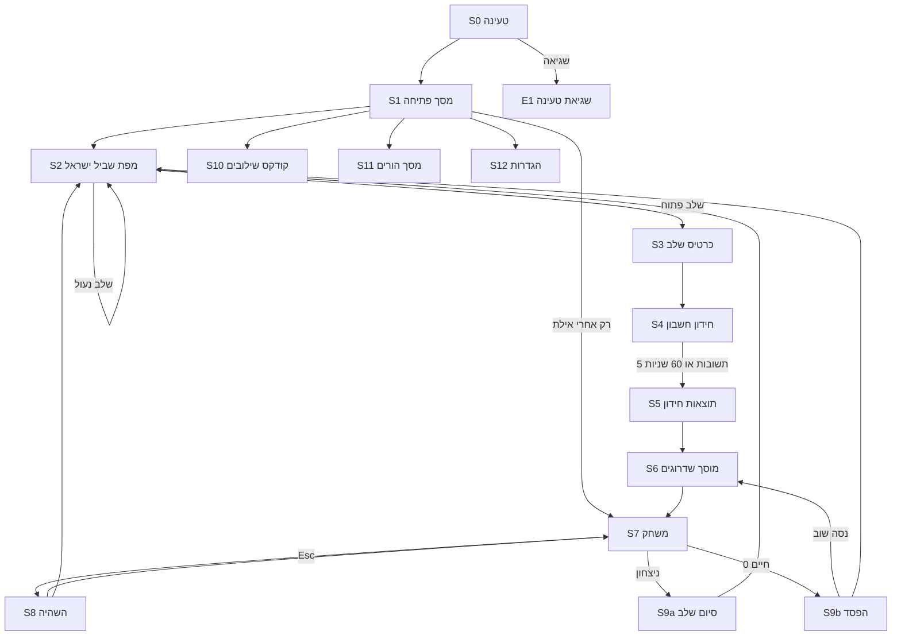

# APP_FLOW: כור הכוכבים · גרסה 2

כל המסכים, המעברים ביניהם, ומה קורה כשאין נתונים או כשיש שגיאה. הממשק בעברית ומימין לשמאל. שדה המשחק (הקנבס) לא מתהפך, רק הטקסטים והתפריטים.

**הלולאה של כל שלב:** מפה ← כרטיס שלב ← חידון (60 שניות) ← תוצאות ומטבעות ← מוסך ← משחק (רקע מתחלף כל 20 שניות) ← ניצחון ← המפה מתקדמת לשלב הבא בשביל.

## מפת מסכים

## מסכים

### S0 טעינה
- **מה רואים:** לוגו ופס התקדמות. נטענות קודם רק התמונות של השלב הנוכחי, והשאר ברקע.
- **שגיאה:** אם קבצים לא נטענו תוך 10 שניות, מעבר ל-E1.

### S1 מסך פתיחה
- **מה רואים:** שם המשחק. כפתור ראשי גדול "המשך בשביל: שלב 3, הכרמל". יתרת מטבעות. כפתורים: קודקס, הגדרות, להורים, הישרדות.
- **מעברים:** המשך ← S2. קודקס ← S10. להורים ← S11. הגדרות ← S12. הישרדות ← S7 (רק אחרי שלב 10).
- **אין נתונים (שחקן חדש):** הכפתור הראשי הוא "צא לשביל! מתחילים בקיבוץ דן". המטבעות 0. הישרדות נעולה עם הסבר "ייפתח כשתגיע לאילת", ולחיצה עליה רק מציגה את ההסבר.
- **שגיאה:** אם השמירה בדפדפן חסומה, מוצג פס צהוב "ההתקדמות לא תישמר במחשב הזה". המשחק עובד.

### S2 מפת שביל ישראל
- **מה רואים:** מפה מאוירת של ארץ ישראל, ים התיכון, הכנרת וים המלח. קו השביל מקיבוץ דן לאילת ועליו 10 נקודות שלבים. החלק שכבר עברו צבוע, החללית עומדת על השלב הנוכחי, והשלבים הבאים אפורים עם מנעול. ליד כל שלב שהושלם יש כוכבים.
- **מעברים:** לחיצה על השלב הנוכחי או על שלב שהושלם ← S3. חזרה ← S1.
- **שלב נעול:** לחיצה מציגה "קודם צריך לעבור את [שם השלב הקודם]" והחללית מהבהבת על השלב הנוכחי. אין מעבר מסך.
- **אין נתונים:** רק שלב 1 (הגליל העליון) פתוח והחללית בקיבוץ דן.
- **שגיאה:** שמירה פגומה מאופסת לשלב 1, עם הודעה "לא הצלחנו לקרוא את ההתקדמות, מתחילים מקיבוץ דן". המטבעות נשמרים אם אפשר לקרוא אותם.

### S3 כרטיס שלב
- **מה רואים:** שם השלב ומספרו, 4 התחנות בדרך (עם תמונות קטנות), האויבים בשלב, והאם יש בוס.
- **מעברים:** "לחידון!" ← S4. חזרה ← S2.
- **שלב שכבר הושלם:** גם כאן עוברים חידון, כי זו הדרך היחידה להרוויח מטבעות.

### S4 חידון חשבון
- **מה רואים:** טיימר יורד של 60 שניות (פס וגם מספר), "שאלה 2 מתוך 5", מונה מטבעות שגדל, התרגיל באותיות גדולות, ו-4 כפתורי תשובה ממוספרים 1 עד 4. כפתור רמקול להקראת השאלה.
- **אחרי תשובה:** נכונה: הכפתור נצבע ירוק, "+10" או "+15" עף למונה. שגויה: הכפתור נצבע אדום, התשובה הנכונה נצבעת ירוק לשנייה אחת. אחר כך מעבר אוטומטי לשאלה הבאה.
- **מעברים:** אחרי 5 תשובות או כשהזמן נגמר ← S5.
- **הזמן נגמר באמצע:** הודעה "נגמר הזמן!" לשנייה, ואז S5. שאלות שלא נענו מסומנות "לא נענתה".
- **החלון מאבד פוקוס:** הטיימר נעצר ומופיע "לחץ כדי להמשיך". ככה אי אפשר להפסיד זמן בטעות.
- **אין יציאה באמצע.** אין כפתור חזרה, כדי שלא ינסו לדלג על שאלות קשות.

### S5 תוצאות חידון
- **מה רואים:** "4 מתוך 5!", רשימה של 5 התרגילים עם וי או איקס והתשובה הנכונה, פירוט מטבעות (תשובות, מהירות, בונוס) ויתרה חדשה.
- **0 נכונות:** "לא נורא! גם בלי מטבעות אפשר לצאת לדרך" וכפתור המשך. אין עונש.
- **מעבר:** "למוסך" ← S6.

### S6 מוסך שדרוגים
- **מה רואים:** יתרת מטבעות בראש. שתי לשוניות: חללית (מגן, מנוע, חיים, זינוק) ונשקים (4 מודולים וכור). כל כרטיס מציג רמה נוכחית מתוך מקסימום, מה השדרוג עושה ומחיר.
- **קנייה:** לחיצה על כרטיס פותחת אישור בתוך המסך ("לקנות מגן רמה 2 ב-80 מטבעות?"). אחרי אישור היתרה יורדת והרמה עולה.
- **אין מספיק מטבעות:** הכרטיס אפור עם "חסרים 25 מטבעות". הכפתור לא פעיל.
- **רמה מקסימלית:** הכרטיס מסומן "מקסימום".
- **מעבר:** "צא לדרך!" ← S7. אפשר לצאת בלי לקנות כלום.

### S7 משחק
- **מה רואים:** שדה המשחק מעל **תמונת רקע של התחנה הנוכחית**. בפינה: שם התחנה ונקודות קטנות שמראות איפה אנחנו מתוך 4. בממשק העליון: ניקוד, גל, חיים, מגן. בתחתית: הכור עם 2 חריצים ושם הנשק.
- **החלפת רקע:** כל 20 שניות הרקע עובר בהדרגה (שנייה אחת) לתחנה הבאה, ושם התחנה מופיע לרגע במרכז למעלה. אחרי התחנה הרביעית חוזרים לראשונה. בהשהיה גם הספירה של 20 השניות נעצרת.
- **פעולות:** חצים או WASD, רווח, Shift, E, Esc.
- **מעברים:** Esc ← S8. ניצחון בגל 5 ← S9a. 0 חיים ← S9b.
- **שגיאה:** תמונת רקע שלא נטענה מוחלפת ברקע מאויר בצבעי האזור (ירוק לצפון, כחול לחוף, חום לנגב), עם שם התחנה. המשחק לא נעצר. אם החלון מאבד פוקוס, השהיה אוטומטית.

### S8 השהיה
- המשך, הגדרות, יציאה למפה (עם אישור בתוך המסך: "השלב לא יישמר, אבל המטבעות והשדרוגים כן").

### S9a סיום שלב
- **מה רואים:** "עברת את הכרמל!", 1 עד 3 כוכבים, ניקוד, שילוב חדש אם התגלה, ומפה קטנה שבה החללית זזה לשלב הבא.
- **מעברים:** "לשלב הבא: מישור החוף" ← S3 של השלב הבא. "למפה" ← S2.
- **אחרי שלב 10:** "הגעת לאילת! עברת את כל שביל ישראל", ונפתח מצב הישרדות.

### S9b הפסד
- **מה רואים:** "החללית נפגעה", ניקוד וגל.
- **מעברים:** "נסה שוב" ← S6 (בלי חידון נוסף, כדי לא לתסכל, ואפשר לקנות שדרוג אם נשארו מטבעות). "למפה" ← S2.

### S10 קודקס שילובים
- 10 כרטיסים. שילוב שהתגלה מציג שם ותיאור. שילוב שלא התגלה מוצג כ-??? עם רמז צבע.
- **אין נתונים:** "עוד לא גילית שילובים. אסוף שני מודולים במשחק ולחץ E".

### S11 מסך הורים
- **כניסה:** תרגיל למבוגרים (למשל 7 × 8). תשובה שגויה מחזירה לפתיחה.
- **מה רואים:** מספר חידונים, אחוז נכונות כללי, אחוז נכונות לפי נושא (חיבור, חיסור, כפל, השוואה, מילוליות), 5 התרגילים שטעו בהם הכי הרבה, והשלב הנוכחי במפה.
- **אין נתונים:** "עוד לא נפתרו חידונים. הנתונים יופיעו אחרי השלב הראשון".

### S12 הגדרות
- עוצמת אפקטים ומוזיקה, הקראת שאלות בקול, הפחתת הבהובים, איפוס התקדמות (עם אישור בתוך המסך, מוחק גם מטבעות ושדרוגים).

### E1 שגיאת טעינה
- "המשחק לא נטען. בדוק את החיבור לאינטרנט ונסה שוב" וכפתור "נסה שוב".
- דפדפן ישן: "הדפדפן הזה לא מתאים. נסה Chrome, Firefox או Edge".
- מסך צר מ-900 פיקסלים: "המשחק מיועד למחשב עם מקלדת" ו"שחק בכל זאת".

## סיכום מצבי קצה

| מצב | איפה | מה קורה |
|---|---|---|
| שחקן חדש | S1, S2, S10, S11 | רק שלב 1 פתוח, 0 מטבעות, קודקס ונתוני הורים ריקים עם הסבר |
| לחיצה על שלב נעול | S2 | הודעה מה צריך לעבור קודם, בלי מעבר |
| הזמן נגמר בחידון | S4 | שאלות שלא נענו נספרות, ממשיכים לתוצאות |
| 0 תשובות נכונות | S5 | עידוד, ממשיכים לשלב בלי מטבעות |
| אין מספיק מטבעות | S6 | כרטיס אפור עם "חסרים X מטבעות" |
| תמונת רקע לא נטענה | S7 | רקע מאויר בצבעי האזור עם שם התחנה |
| איבוד פוקוס | S4, S7 | טיימר החידון נעצר, המשחק עובר להשהיה |
| שמירה חסומה או פגומה | S1, S2 | פס אזהרה או איפוס לשלב 1 עם הודעה |
| כשל טעינה | S0 | E1 עם נסה שוב |
